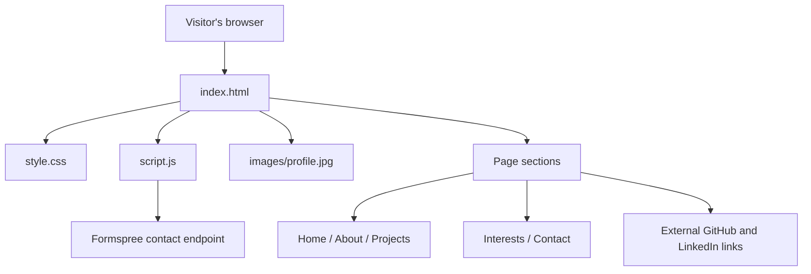
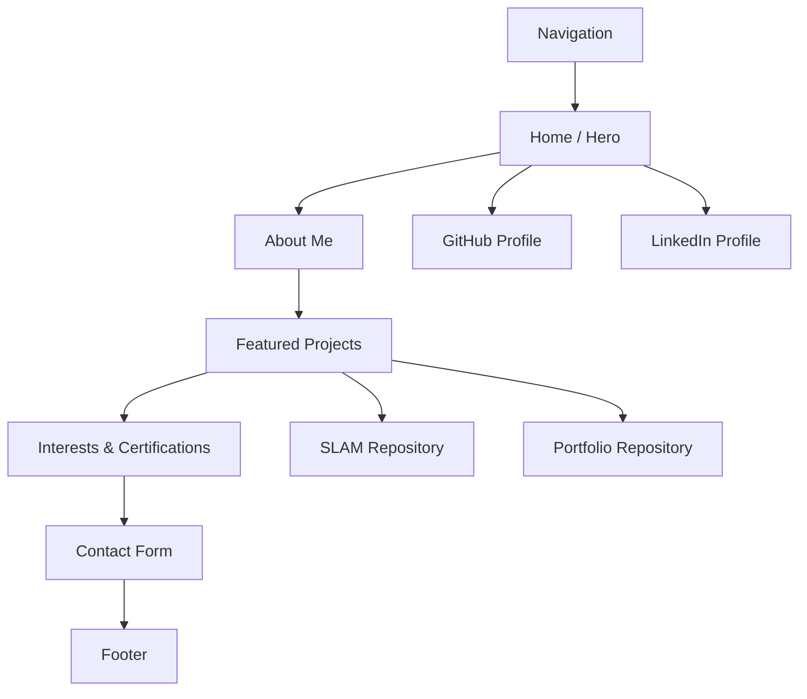
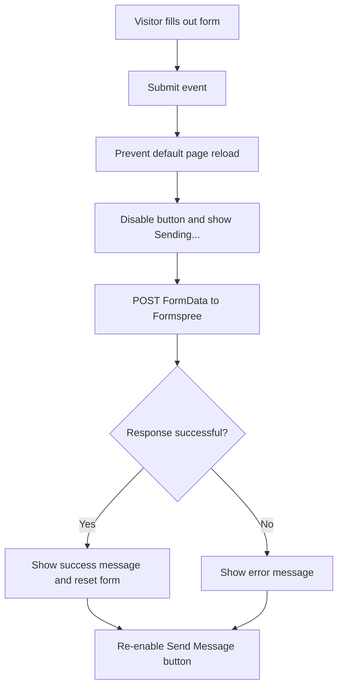

# Personal Portfolio Website

A personal portfolio website for **Stenneth Swaby**, built from scratch with **HTML5, CSS3, and vanilla JavaScript** as both a professional portfolio and a hands-on web development learning project.

The website introduces my background in computer science, U.S. Navy service, robotics research, and ongoing graduate studies in engineering management. It also highlights selected projects, interests and certifications, and provides a way to get in touch.

> **Project status (October 12, 2026):** Core website and local testing completed. Final cross-device testing, GitHub verification, and deployment are the next steps.

## Features

- **Responsive, minimalist design:** Dark background, light typography, generous spacing, and layouts that adapt to smaller screens.
- **Home:** Introduction, profile photograph, and prominent buttons for Explore My Work, GitHub, and LinkedIn.
- **About:** Background in the U.S. Navy, computer science, robotics research, and engineering management.
- **Projects:** Two project cards with technology tags and links to their respective GitHub repositories.
- **Interests & Certifications:** Aviation and scuba diving credentials.
- **Contact:** Accessible form that sends messages through Formspree without publishing a personal email address in the page source.
- **Interaction:** Smooth section navigation, subtle hover effects, and asynchronous form submission with status feedback.

## Technologies

| Technology | How it is used |
| --- | --- |
| HTML5 | Semantic page structure, navigation, content, and form elements |
| CSS3 | Layout, typography, responsive grids, buttons, and hover states |
| JavaScript (vanilla) | Contact form submission, loading state, and success/error messages |
| Formspree | Receives contact form submissions |
| Git & GitHub | Version control, source hosting, and project links |
| Python HTTP server | Runs the static website locally during development |
| VS Code | Code editing and debugging |

No frontend framework, package manager, or build step is required.

## Project Structure

```text
website/
├── index.html          # Page structure and content
├── style.css           # Visual design and responsive layout
├── script.js           # Contact form behavior
├── images/
│   └── profile.jpg     # Profile photograph
├── resume/             # Reserved for a future resume asset
├── README.md           # Project documentation
└── .gitignore          # Git ignore rules
```

## Architecture Diagram



The browser loads a static HTML page. CSS handles presentation, while JavaScript adds behavior to the contact form. Formspree is the only external service needed for form delivery.

## Page Layout Diagram



On larger screens, the two project cards are displayed in a two-column CSS Grid. At viewport widths of **768 px or less**, they stack into one column for readability.

## Contact Form Workflow



The form uses `fetch()` and `FormData`, sends an `Accept: application/json` header, and updates a live status message. It has been tested successfully in the local development environment.

## Run Locally

1. Clone the repository:

   ```bash
   git clone https://github.com/StennethSwaby/website.git
   cd website
   ```

2. Start a local HTTP server:

   ```bash
   python3 -m http.server 8000
   ```

3. Open **http://localhost:8000** in a browser.

4. Edit the files in VS Code, save, and refresh the browser to see changes. Press `Ctrl+C` in the server terminal when finished.

A useful workflow is to keep **one terminal running the local server** and **another terminal available for Git commands**.

## Projects Highlighted

### SLAM Algorithm Comparison

Undergraduate robotics research comparing **SLAM Toolbox** and **Google Cartographer** using a **TurtleBot3** and **ROS 2**, with Python used to support mapping evaluation and analysis.

**Technologies:** Python · ROS 2 · SLAM · Robotics  
**Repository:** https://github.com/StennethSwaby/Capstone

### Personal Portfolio Website

This website: a framework-free, responsive portfolio built to practice the fundamentals of web development while presenting my background and work.

**Technologies:** HTML5 · CSS3 · JavaScript · Git  
**Repository:** https://github.com/StennethSwaby/website

## Development Progress

### Completed

- [x] Rebuilt the site from scratch using plain HTML, CSS, and JavaScript.
- [x] Created semantic sections and anchor-based navigation.
- [x] Added a hero section with a profile image.
- [x] Wrote About, Projects, Interests, and Contact sections.
- [x] Built responsive project and interests card grids.
- [x] Added GitHub and LinkedIn profile buttons to the hero section.
- [x] Added repository-specific links beneath project technology tags.
- [x] Connected the contact form to Formspree and tested delivery locally.
- [x] Added asynchronous form feedback and disabled-button behavior during submission.
- [x] Debugged a layout issue caused by extra HTML closing tags.


## Lessons Learned

### HTML structure matters

A missing or extra closing tag can move an element outside its intended parent container. During development, two extra closing tags after the first project card caused the second card to appear outside `.projects-grid`, breaking the two-column layout. Inspecting the parent/child structure identified the issue.

### CSS Grid and Flexbox solve different layout problems

- **CSS Grid** places the project cards in two columns and switches to one column on narrow screens.
- **Flexbox** arranges navigation links, hero buttons, and technology tags, allowing wrapping where appropriate.

### JavaScript can improve a simple static website

The contact form uses an event listener, `event.preventDefault()`, `async`/`await`, `fetch()`, `try`/`catch`/`finally`, and DOM updates to submit messages without a full page reload.

### Small changes are easier to debug

Editing one section at a time, saving, refreshing the browser, and checking HTML nesting before changing CSS helped isolate layout problems.

## AI-Assisted Development

AI was used as a **learning and coding assistant** throughout the project: to explain HTML, CSS, and JavaScript concepts; suggest small implementation steps; help structure the portfolio; and troubleshoot errors. Code was reviewed, edited, and tested locally as part of the learning process.

### Reusable AI Continuation Prompt

> I am building my personal portfolio website as a hands-on web development learning project. My GitHub repository is `StennethSwaby/website`, and my local Ubuntu project folder is `~/website`.
>
> I deliberately restarted the website from scratch using **HTML5, CSS3, and vanilla JavaScript**, rather than a framework such as Next.js. I am learning step by step, so explain what each change does, keep edits small, and do not rewrite working sections unnecessarily.
>
> My files are `index.html`, `style.css`, `script.js`, `images/profile.jpg`, `README.md`, and `.gitignore`. I use VS Code and run the site locally with `python3 -m http.server 8000`, then visit `http://localhost:8000`.
>
> The design is minimalist: near-black background, white and gray text, generous spacing, rounded dark project cards, and responsive layouts. The page contains a navigation bar and five sections: **Home, About, Projects, Interests, and Contact**, followed by a footer.
>
> **Home:** Contains my name, a short introduction, profile photo, and three similarly styled buttons: **Explore My Work**, **GitHub**, and **LinkedIn**. The GitHub profile is `https://github.com/StennethSwaby`; confirm my actual LinkedIn URL rather than inventing one.
>
> **About:** Covers my U.S. Navy Hospital Corpsman background, B.S. in Computer Science with a Chinese minor from The College of New Jersey, robotics/SLAM research, and ongoing M.S. in Engineering Management at UMass Lowell. I want to refine the writing after the site is deployed.
>
> **Projects:** Two side-by-side cards on desktop, stacking on mobile. The first is **SLAM Algorithm Comparison**, with Python, ROS 2, SLAM, and Robotics tags and a repository link to `https://github.com/StennethSwaby/Capstone`. The second is **Personal Portfolio Website**, with HTML5, CSS3, JavaScript, and Git tags and a repository link to `https://github.com/StennethSwaby/website`. Keep each `View on GitHub` link **outside** the `.project-tags` div but inside its `.project-card`. Both cards must remain inside the same `.projects-grid` container. We previously fixed a bug where two extra closing tags after Project 1 caused Project 2 to stretch across the page.
>
> **Interests:** Includes an FAA Private Pilot Certificate (Airplane Single-Engine Land) and NAUI Advanced Open Water Diver plus Nitrox certification. Do not imply I am currently flight-current. Later, add official FAA and NAUI reference links.
>
> **Contact:** Uses a real Formspree endpoint already configured in my HTML; do not overwrite it with a placeholder. The form has name, email, and message fields. `script.js` intercepts submission, sends `FormData` using `fetch()`, disables the submit button while sending, and displays success or error feedback. I have tested successful delivery locally.
>
> **Current progress as of October 12, 2026:** The core site works locally, the profile image displays, the contact form sends, and the project cards are side by side again. I am pausing before final testing, committing/pushing all intended files, and deploying the site, likely with GitHub Pages.
>
> **How to help me next:** Resume with a short check of the current project state. Then guide me through Phase 5: responsive/accessibility testing, Git status and commits, GitHub verification, deployment, and live-site testing. Explain each command and its purpose. Preserve the existing black-and-white visual style, and ask for my current code when a fix depends on exact HTML nesting.

## License and Content

This repository contains my personal portfolio content and images. No open-source license is specified here; do not assume the content or photographs are licensed for reuse.

---

*Built as a personal learning project and updated incrementally.*